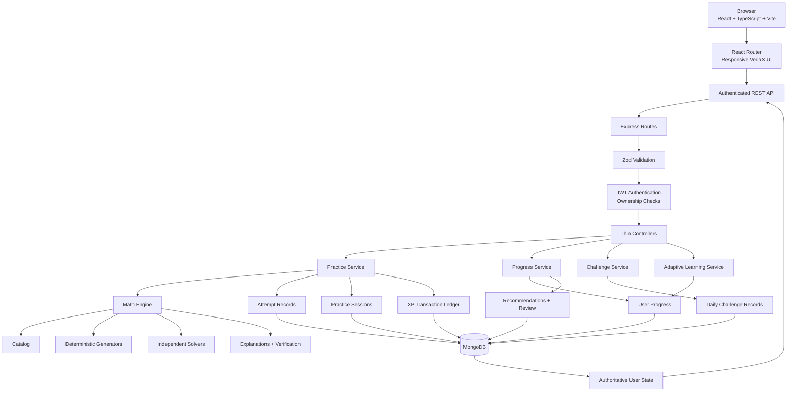
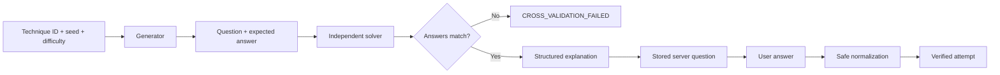

# VedaX

**VedaX is a responsive Vedic Mathematics learning platform that turns the 16 classical sutras into a structured, measurable practice experience.**

> Learn the method. Practice the pattern. Trust the answer.

[](https://github.com/Aryaaa-21/VedaX/actions/workflows/ci.yml)
[](https://nodejs.org/)
[](https://react.dev/)
[](https://www.mongodb.com/)

## What I Built

VedaX is a web application for learners who want to improve mental calculation speed using Vedic Mathematics. It combines:

- a 16-technique Vedic Mathematics curriculum;
- technique explanations, examples, and guided practice;
- a practice arena and timed challenge modes;
- daily challenges and streak tracking;
- progress, XP, level, mastery, mistakes, and recommendations;
- prerequisite-aware adaptive learning;
- a deterministic mathematical engine that cross-validates every generated question;
- a responsive React frontend and an authenticated Express/MongoDB backend.

The important design decision is that the browser is not trusted with learning outcomes. The server owns question generation, answer verification, attempts, scoring, XP, mastery, streaks, and reward idempotency.

## The problem

Many mental-math learning apps are either static content libraries or client-only games. That creates two problems:

1. Learners do not get a clear path from a sutra explanation to measurable mastery.
2. A modified browser can change its own score, XP, streak, or answer state.

VedaX addresses both by pairing educational content with a verified mathematical engine and a server-authoritative learning model.

## The solution in one screen

```text
Choose a technique
       ↓
Learn the sutra and examples
       ↓
Receive a deterministic server-owned question
       ↓
Submit an answer
       ↓
Server verifies it against the stored question
       ↓
Attempt → score → XP → mastery → streak → recommendation
```

## Demo

- **Source repository:** [github.com/Aryaaa-21/VedaX](https://github.com/Aryaaa-21/VedaX)
- **Live demo:** add the deployed frontend URL here when the production deployment is public.
- **API health check:** add the deployed `/health` URL here when the backend is public.
- **Walkthrough video:** add a video URL here when available.

The repository includes the frontend and backend deployment configuration, but a live URL is intentionally not invented here. The application can be run locally using the instructions below.

## Screenshots

Add VedaX screenshots here for a published project post. Recommended captures:

1. Landing page and 16-sutra curriculum introduction.
2. Technique library on desktop and mobile.
3. Practice Arena question flow.
4. Daily Challenge timer and completion state.
5. Dashboard progress, streak, and mastery cards.
6. Responsive mobile navigation drawer and bottom navigation.

The approved VedaX visual direction is preserved: warm mathematical palette, Vedic pattern accents, card-based learning surfaces, and a responsive desktop/mobile navigation system.

## Code

### Repository structure

```text
VedaX/
├── backend/
│   ├── config/                 Environment and MongoDB configuration
│   ├── controllers/            Thin HTTP handlers
│   ├── middleware/             Auth, validation, rate limiting, errors
│   ├── models/                 Mongoose schemas and indexes
│   ├── routes/                 REST route definitions
│   ├── services/
│   │   └── math/               Generators, solvers, explanations, verification
│   ├── tests/                  API, security, learning, and math tests
│   └── validators/             Zod request schemas
├── frontend/
│   ├── src/app/                Landing and dashboard pages
│   ├── src/components/         Navbar, sidebar, navigation, visual components
│   ├── src/contexts/           Authentication context
│   ├── src/store/              Zustand UI/gameplay state
│   └── src/utils/              API and feedback utilities
├── docs/                       Architecture, API, math, security, release docs
├── .github/                    CI, issue forms, and PR template
├── Dockerfile                  Reproducible backend + frontend image build
├── Makefile                    Standard project checks
├── render.yaml                 Render backend configuration
├── railway.json                Railway backend configuration
├── vercel.json                 Vercel frontend configuration
└── netlify.toml                Netlify frontend configuration
```

### Stable mathematical engine API

The engine is independent from Express and MongoDB. It can be tested as a pure module:

```js
const {
  generateVerifiedQuestion,
  verifyAnswer
} = require("./backend/services/math");

const question = generateVerifiedQuestion({
  techniqueId: "nikhilam-subtraction",
  seed: "demo-session:0",
  difficulty: 2
});

const result = verifyAnswer(question, "9604");

console.log({
  prompt: question.prompt,
  correct: result.correct
});
```

Every generated question is cross-checked by an independent solver before it can enter a practice session:

```js
const question = generateQuestion(options);
const solved = solveQuestion(question);

if (solved !== question.expectedAnswer) {
  throw new MathEngineError(
    `Cross-validation failed for ${question.techniqueId}`,
    "CROSS_VALIDATION_FAILED"
  );
}
```

The public question response deliberately excludes `expectedAnswer` and `solutionData`:

```js
const publicQuestion = (question) => ({
  id: question.id,
  sequence: question.sequence,
  techniqueId: question.techniqueId,
  operation: question.operation,
  difficulty: question.difficulty,
  text: question.prompt,
  question: question.prompt
});
```

### Server-authoritative practice

The client submits an answer. It does not submit correctness, XP, mastery, streak, or score:

```text
POST /api/practice/sessions/:sessionId/attempts

{
  "sequence": 0,
  "answer": "9604",
  "responseTimeMs": 1840,
  "hintUsed": false,
  "idempotencyKey": "attempt-unique-key"
}
```

The backend then performs:

```text
stored server question
        ↓
safe answer normalization
        ↓
mathematical verification
        ↓
Attempt document
        ↓
server score
        ↓
UserProgress mastery update
        ↓
session completion
        ↓
idempotent XPTransaction
        ↓
server streak update
```

### XP reward idempotency

XP rewards use a unique user/idempotency-key constraint and a MongoDB transaction for the ledger plus user aggregate update:

```js
await session.withTransaction(async () => {
  const created = await XPTransaction.create([
    { userId, amount: safeAmount, sourceType, sourceId, reason, idempotencyKey }
  ], { session });

  await User.findByIdAndUpdate(
    userId,
    { $inc: { xp: safeAmount } },
    { new: true, runValidators: true, session }
  );
});
```

One qualifying event is intended to produce one reward, even when a request is retried or two completion requests arrive close together.

## How I Built It

VedaX follows a simple architecture: the frontend is responsible for presentation and interaction, while the backend is responsible for facts that affect learning outcomes.

### The stack

| Layer | Technology | Responsibility |
| --- | --- | --- |
| Interface | React 19, TypeScript, Vite | Responsive learning experience and navigation |
| Styling | Tailwind CSS 4, custom CSS variables | Existing VedaX visual language and responsive layout |
| Interaction | Zustand, Framer Motion, Lucide React | UI state, transitions, icons, feedback |
| API | Node.js, Express | Authentication, validation, practice, progress, challenge APIs |
| Database | MongoDB, Mongoose | Users, sessions, attempts, progress, XP ledger |
| Validation | Zod | Request body and query validation |
| Authentication | JWT, bcrypt | Sessions, password hashing, token revocation |
| Mathematics | Deterministic JavaScript services | Generation, solving, explanations, verification |
| Testing | Node test runner, Supertest, TypeScript, ESLint | Backend/API/math/security and frontend checks |
| Deployment | Docker, Render, Railway, Vercel, Netlify configs | Reproducible deployment paths |

### The architecture



### The mathematical pipeline



### Difficulty and mastery

Adaptive learning is deterministic rather than artificial intelligence. It uses persisted facts:

- recent correctness;
- recent accuracy;
- response time;
- consecutive mistakes;
- mastery score;
- review date;
- prerequisite gaps;
- technique history.

The result is explainable. A recommendation can say:

> Practice this technique because your recent accuracy is low or your review date is overdue.

It does not claim that a hidden AI model made the decision.

## The bugs and design decisions that mattered

### A client must not be able to award itself XP

The original UI contains local gameplay state for compatibility with the approved frontend. The production learning API does not trust that state. The backend ignores client-provided learning outcomes in the compatibility sync route and calculates outcomes from verified events.

### A generated question must fail loudly when mathematics disagrees

The math engine does not silently accept a mismatched solver or explanation. A generator/solver mismatch throws `CROSS_VALIDATION_FAILED`, which makes the error visible in tests and logs instead of teaching an incorrect answer.

### A duplicate request must not duplicate a reward

Attempt uniqueness, session completion claiming, and XP transaction idempotency are separate protections. This matters because users retry network requests, mobile browsers reconnect, and two tabs can submit the same completion.

### Responsive behavior is part of correctness

The frontend was kept visually consistent while fixing practical issues:

- desktop sidebar width and content offset now use the same valid spacing;
- mobile drawer width adapts to narrow viewports;
- bottom navigation respects safe-area insets;
- page shells prevent accidental horizontal overflow;
- navigation labels truncate safely on very small screens;
- reduced-motion preferences are respected;
- invalid fractional icon utilities were replaced with reliable sizes.

## Why Does Open Innovation Matter?

VedaX does not use a hosted AI model and does not pretend to. Its open-source value is in making the educational and mathematical boundaries inspectable:

1. Contributors can audit the exact generator, solver, explanation, and verification code.
2. New techniques can be added through a documented process instead of a hidden content pipeline.
3. Contributors can add randomized mathematics tests and reproduce failures with deterministic seeds.
4. The server-authoritative learning rules are visible and reviewable.
5. The frontend can be improved without replacing the backend learning contract.

The project deliberately uses deterministic learning heuristics rather than calling them AI. That keeps recommendations reproducible and makes a wrong result easier to diagnose.

## AI Disclosure

VedaX does not currently use a generative AI model, remote AI API, or AI-generated answer path in its runtime. Mathematical generation, answer checking, mastery, recommendations, and adaptive difficulty are deterministic application code.

If a future contributor adds an AI-assisted educational feature, it must remain separate from authoritative correctness and reward calculations, be documented in this section, and include tests for unavailable or incorrect model responses.

## My Agent Session

This project was developed through repository-driven implementation and verification. The important reproducibility boundary is the checked-in code and test suite, not an unverified assistant transcript.

The repository records the implementation through:

- focused conventional commits;
- pinned Node.js and lockfiles;
- offline backend tests;
- frontend typecheck, lint, and build commands;
- CI configuration;
- architecture, security, release, and contributor documentation.

No public agent-session transcript is linked because none is required to rebuild or review the application.

## My First User

This repository does not claim a verified paying customer or testimonial. The intended first users are:

- students learning mental arithmetic;
- teachers who want structured supplementary practice;
- competitive-exam learners;
- educators contributing new examples or technique tests;
- open-source contributors interested in trustworthy educational software.

The first useful milestone is not a fabricated growth number. It is a learner completing a technique, understanding the explanation, and returning to practice the next review item.

## Prize Categories / Challenge Fit

The following are the honest project categories VedaX fits. They should be adjusted to the exact event requirements before publishing a challenge submission:

### Education

VedaX turns a traditional mathematical system into an interactive, measurable learning workflow.

### Open Source

The repository includes contributor documentation, a technique guide, issue forms, a pull request template, CI, and reproducible setup instructions.

### Testing and Trustworthy Software

The project treats mathematical cross-validation, server authority, idempotency, and security tests as core product functionality rather than optional cleanup.

### Responsive Web Application

The approved VedaX interface works across desktop, tablet, and mobile layouts without replacing the existing design direction.

## Who Would Use This?

VedaX is useful for people who want a repeatable way to practice rather than a one-time calculator:

- **Students:** learn one sutra, see an example, and practice it immediately.
- **Teachers:** use the technique catalog and mastery data as supplementary practice material.
- **Exam learners:** build speed and accuracy through timed sessions.
- **Math enthusiasts:** compare different mental calculation strategies.
- **Contributors:** add a mathematically validated technique or improve the test suite.

The project is not a replacement for a teacher, curriculum, or conventional mathematics education. It is a practice and explanation tool.

## Team Submissions

VedaX is maintained as a single repository. If this project is submitted as a team entry, add the participating DEV/GitHub usernames here before publishing the submission. No team member names are invented in this README.

## Verification and deployment

### Backend tests

```bash
make test
```

The backend suite covers authentication, protected routes, profile field protection, leaderboard authority, malformed requests, learning utilities, scoring, streaks, stable technique IDs, deterministic generation, randomized cross-validation, normalization, and explanation structure.

### Frontend checks

```bash
make frontend-typecheck
make frontend-lint
make frontend-build
```

### Dependency audit

```bash
npm --prefix backend audit --omit=dev
npm --prefix frontend audit --omit=dev
```

The backend production audit is clean. The frontend has two deferred moderate React Router advisories whose available fix requires a breaking upgrade. That upgrade is intentionally separate from the approved frontend/responsive maintenance work.

### Docker

```bash
docker build -t vedax .
docker run --rm -p 5000:5000 --env-file backend/.env vedax
```

The Dockerfile builds the frontend artifact and runs the backend. Docker verification must be performed in an environment with Docker installed and a transaction-capable MongoDB deployment.

## Installation

### Requirements

- Node.js `22.23.3` from `.nvmrc`;
- npm;
- MongoDB for local backend runtime;
- Docker only if using the container workflow.

### Install dependencies

```bash
npm ci
npm --prefix frontend ci
npm --prefix backend ci
```

### Configure environment files

```bash
cp backend/.env.example backend/.env
cp frontend/.env.example frontend/.env.local
```

Set a local MongoDB connection string and a development JWT secret in `backend/.env`. Never commit the resulting `.env` files.

## Environment variables

### Backend

| Variable | Required | Description |
| --- | --- | --- |
| `MONGODB_URI` | Yes | MongoDB connection string |
| `JWT_SECRET` | Yes | JWT signing secret; production requires at least 32 characters |
| `JWT_EXPIRES_IN` | No | JWT lifetime, defaults to `30d` |
| `NODE_ENV` | No | `development`, `test`, or `production` |
| `PORT` | No | API port, defaults to `5000` |
| `CLIENT_URL` | No | Primary frontend origin |
| `CORS_ORIGINS` | No | Additional comma-separated origins |
| `ALLOW_PREVIEW_ORIGINS` | No | Non-production preview allowlist switch |
| `BODY_LIMIT` | No | JSON body limit, defaults to `64kb` |

### Frontend

| Variable | Required | Description |
| --- | --- | --- |
| `VITE_API_URL` | No | Backend API base URL; local default is `http://localhost:5000/api` |

## Development

Run the services in separate terminals:

```bash
npm run dev:backend
npm run dev:frontend
```

Or run both together:

```bash
npm run dev
```

Default local URLs:

- frontend: `http://localhost:5173`;
- API: `http://localhost:5000`;
- health: `http://localhost:5000/health`;
- readiness: `http://localhost:5000/ready`.

## API overview

All protected routes use `Authorization: Bearer <JWT>`. Protected data is scoped to the authenticated user.

### Authentication

| Method | Route | Purpose |
| --- | --- | --- |
| `POST` | `/api/auth/signup` | Validate and create an account |
| `POST` | `/api/auth/login` | Authenticate and return a JWT |
| `GET` | `/api/auth/me` | Return the safe authenticated user |
| `GET` | `/api/auth/verify` | Verify the current JWT |
| `POST` | `/api/auth/logout` | Increment token version and revoke the current token |

### Practice and progress

| Method | Route | Purpose |
| --- | --- | --- |
| `POST` | `/api/practice/sessions` | Start a server-owned question session |
| `POST` | `/api/practice/sessions/:id/attempts` | Verify and record one answer |
| `POST` | `/api/practice/sessions/:id/complete` | Complete a session and award idempotent XP |
| `GET` | `/api/practice/sessions/:id` | Read the authenticated user's session |
| `GET` | `/api/practice/history` | Read completed session history |
| `GET` | `/api/progress` | Read summary, techniques, and recommendations |
| `GET` | `/api/progress/summary` | Read authoritative user progress summary |
| `GET` | `/api/progress/techniques` | Read technique mastery records |
| `GET` | `/api/progress/recommendations` | Read deterministic recommendations |
| `GET` | `/api/progress/xp-history` | Read the XP transaction ledger |
| `GET` | `/api/progress/mistakes` | Read grouped incorrect-attempt analysis |

### Challenges and learning intelligence

| Method | Route | Purpose |
| --- | --- | --- |
| `GET` | `/api/challenges/daily` | Read the date/versioned daily challenge |
| `POST` | `/api/challenges/daily/start` | Start the server-owned daily session |
| `POST` | `/api/challenges/daily/:sessionId/complete` | Complete the daily session |
| `GET` | `/api/challenges/history` | Read own completed challenges |
| `GET` | `/api/learning/learner` | Read the deterministic learner profile |
| `GET` | `/api/learning/path` | Read prerequisite-aware next techniques |
| `GET` | `/api/learning/difficulty/:techniqueId` | Read bounded server-derived difficulty |
| `GET` | `/api/techniques` | Read the stable technique catalog |
| `GET` | `/api/techniques/:techniqueId` | Read one technique |

### User, leaderboard, and service status

| Method | Route | Purpose |
| --- | --- | --- |
| `GET` | `/api/user/profile` | Read own profile |
| `PUT` | `/api/user/profile` | Update editable profile fields |
| `POST` | `/api/user/sync` | Compatibility profile sync; learning outcomes are ignored |
| `GET` | `/api/leaderboard` | Read database-backed rankings |
| `GET` | `/health` | Liveness status |
| `GET` | `/ready` | Readiness status; requires MongoDB |

Errors use a stable JSON shape:

```json
{
  "success": false,
  "message": "Invalid request",
  "error": {
    "code": "VALIDATION_ERROR",
    "message": "Invalid request",
    "fields": {
      "email": "Enter a valid email address"
    }
  }
}
```

For full request, response, validation, and error details, see [docs/api.md](docs/api.md).

## Mathematical engine

VedaX currently preserves these 16 stable technique IDs:

```text
ekadhikena-purvena
nikhilam-subtraction
sankalana-vyavakalanabhyam
yavadunam
ekanyunena-purvena
vyastisamastih
vertically-crosswise
anurupyena
puranapuranabhyam
sesanyankena-caramena
sopantyadvayamantyam
paravartya-yojayet
sunyam-samyasamuccaye
chalana-kalanabhyam
gunitasamuccayah
gunakasamuccayah
```

Each technique must have:

- catalog metadata;
- a deterministic generator;
- an independent solver;
- structured explanation steps;
- safe answer normalization and verification;
- normal, invalid, boundary, and randomized tests.

The engine never uses `eval()`, `new Function()`, or arbitrary expression evaluation.

Read [docs/mathematical-engine.md](docs/mathematical-engine.md) and [docs/adding-a-technique.md](docs/adding-a-technique.md) before changing the math engine.

## Security

The backend includes:

- bcrypt password hashing;
- HS256 JWT verification and token-version revocation;
- authenticated ownership queries;
- Helmet security headers;
- exact CORS allowlisting;
- bounded JSON bodies;
- Zod validation;
- authentication and API rate limits;
- safe error payloads;
- server-owned questions and answer verification;
- idempotent attempt and reward records;
- conditional session completion claims;
- transactional XP ledger and user updates.

Do not submit passwords, tokens, keys, or private data in GitHub issues. See [SECURITY.md](SECURITY.md) for private vulnerability reporting guidance.

## Deployment

### Frontend

The frontend can be deployed from `frontend/` to Vercel or Netlify. Configure `VITE_API_URL` with the deployed backend API base URL.

### Backend

Railway and Render configuration files are included. Configure:

```text
MONGODB_URI
JWT_SECRET
NODE_ENV=production
PORT
CLIENT_URL
```

Use a transaction-capable MongoDB deployment for production rewards. `/ready` should be used as the deployment readiness check because it verifies database connectivity.

### Docker

The multi-stage Dockerfile builds the frontend and runs the backend:

```bash
docker build -t vedax .
docker run --rm \
  -p 5000:5000 \
  --env-file backend/.env \
  vedax
```

## Contributing

Before opening a pull request:

```bash
make test
make frontend-typecheck
make frontend-lint
make frontend-build
```

Focused contribution areas:

- add a Vedic technique with complete cross-validation;
- add mathematical boundary and randomized tests;
- improve API documentation;
- improve accessibility without changing the visual language;
- improve responsive behavior without redesigning approved pages;
- improve performance with measured evidence;
- fix backend validation, security, or data-consistency bugs;
- improve educational explanations and examples.

The frontend is an approved baseline. Change it only for backend integration, a genuine functional/security bug, production compatibility, or targeted responsive behavior. If frontend files change, the pull request must list each file, the reason, and why the existing UI/UX remains unchanged.

Read:

- [CONTRIBUTING.md](CONTRIBUTING.md)
- [docs/adding-a-technique.md](docs/adding-a-technique.md)
- [docs/architecture.md](docs/architecture.md)
- [docs/release-checklist.md](docs/release-checklist.md)

## Pull requests and issues

The repository includes forms for:

- bug reports;
- feature requests;
- new Vedic techniques;
- mathematical errors;
- documentation improvements;
- security-report redirection.

Please include reproduction steps, tests, security impact, and mathematical validation where relevant. Do not create placeholder issues merely to increase issue count; proposed work should be real, scoped, and actionable.

## Roadmap

- complete the gradual migration from local gameplay state to server-owned practice sessions;
- add live MongoDB replica-set integration tests for transactions and concurrency;
- expand test coverage for cross-user ownership and duplicate requests;
- add more technique examples and contributor-authored educational content;
- measure and improve the frontend bundle without changing the approved experience;
- resolve the deferred frontend dependency audit findings in a controlled maintenance release;
- select and publish an appropriate open-source license.

## Release status

The project is production-oriented but should not be called fully release-ready until the project owner selects a license and live MongoDB transaction behavior is verified in the target deployment environment.

See [docs/release-checklist.md](docs/release-checklist.md) for the complete pre-release checklist.

## License

No `LICENSE` file is currently committed. This is intentional pending a project-owner decision. Do not assume that the repository is licensed for redistribution or reuse until a license is selected and added.

## Acknowledgements

VedaX is inspired by the educational tradition of Vedic Mathematics and by the open-source ecosystem that makes reproducible learning software possible.

## Project links

- [GitHub repository](https://github.com/Aryaaa-21/VedaX)
- [Architecture](docs/architecture.md)
- [API reference](docs/api.md)
- [Mathematical engine](docs/mathematical-engine.md)
- [Adaptive learning](docs/adaptive-learning.md)
- [Security policy](SECURITY.md)
- [Contributor guide](CONTRIBUTING.md)
- [Code of Conduct](CODE_OF_CONDUCT.md)

## Thanks for participating

Thank you for reviewing VedaX. The project is intentionally built around a small promise: make mental-math practice more understandable, measurable, and trustworthy without hiding the important rules behind an opaque system.
